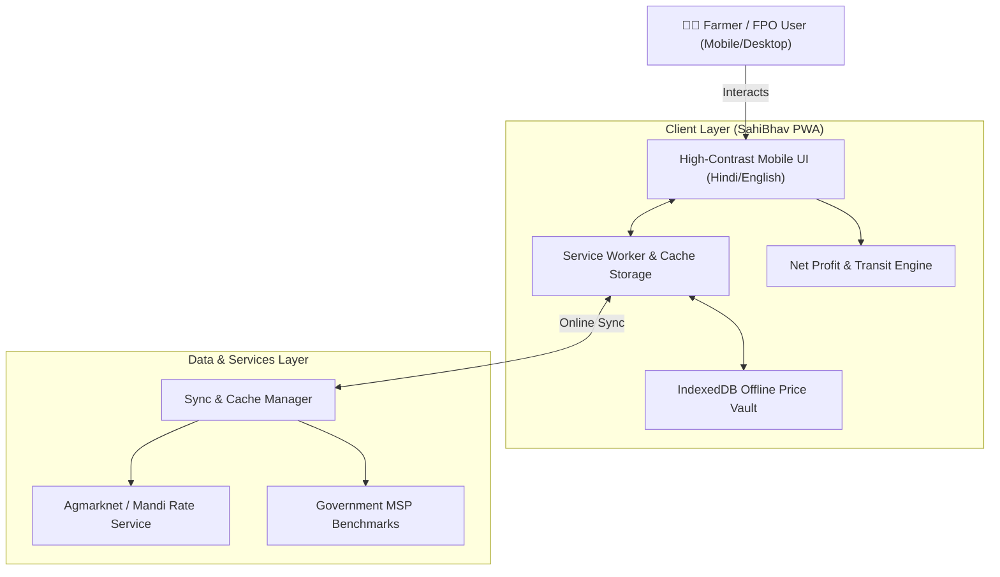

# SahiBhav 🌾 (सही भाव)
> **Farmer-First Mandi Price Transparency & Smart Selling Decision Engine**  
> *Empowering Indian farmers with real-time crop rates, nearby mandi comparison, MSP benchmarks, and net profit calculations.*

[](LICENSE)
[](#tech-stack)
[](#features)
[](#offline-first-architecture)
[](#roadmap)

---

## 📌 Problem Statement
Across India, smallholder farmers often face severe **information asymmetry** when selling their harvest:
1. **Uncertain Market Rates:** Crop prices vary significantly between mandis located just 15–30 km apart on the same day.
2. **Hidden Logistics Costs:** Higher prices at a distant mandi do not always mean higher net profit once tractor/tempo fuel and loading charges are factored in.
3. **Connectivity Gaps:** Mandis and rural farm clusters frequently suffer from spotty 2G/3G network coverage, causing web apps to fail.
4. **Language & Interface Barriers:** Most government portals are complex, desktop-oriented, and not designed for regional-language-first mobile interaction.

---

## 💡 The Solution: SahiBhav (सही भाव)
**SahiBhav** bridges this gap with an intuitive, mobile-optimized, offline-capable progressive web application tailored for farmers, farmer producer organizations (FPOs), and rural traders:

- 📊 **Real-time Mandi Price Comparison:** Compare today's arrival rates across local and neighboring mandis.
- 🚚 **Net Profit & Distance Calculator:** Calculates transport expense (fuel + vehicle type) to tell farmers the *actual take-home profit* at each mandi.
- ⚖️ **MSP Benchmark Indicator:** Immediate visual cue showing whether current mandi bids are above or below the government Minimum Support Price (MSP).
- 📶 **Offline-First PWA:** Cached price data ensures farmers can inspect rates and run calculations even deep in rural fields without active internet.
- 🇮🇳 **Hindi-First UI & High Contrast:** Designed for sunlight visibility, large touch targets, regional number formatting, and instant Hindi/English switching.

---

## 🌟 Key Features

| Feature | Description |
|:---|:---|
| **🌾 Smart Crop Search & Filter** | Search by crop name in Hindi/English (e.g., *गेहूं / Wheat*, *चना / Gram*, *सरसों / Mustard*) with state and district filters. |
| **📍 Mandi Proximity Matrix** | View prices side-by-side sorted by distance, price difference, or arrival volume. |
| **💰 "Sahi Munafa" Calculator** | Input estimated harvest quantity (Quintals) and vehicle type to see exact profit after transit. |
| **📈 7-Day Price Trends** | Simple trend lines showing whether market rates for a crop are rising, falling, or stable. |
| **⚡ 100% Offline Capability** | Offline caching with Service Workers and IndexedDB ensures uninterrupted access. |
| **🔊 Voice-Friendly & Accessible** | High contrast UI, clean typography, and conversational audio cues. |

---

## 🏗️ System Architecture



---

## 🛠️ Tech Stack

- **Frontend & App Core:** React 19 / Modern JavaScript, Vite
- **Styling & Design System:** Custom responsive CSS design system (solarized contrast for outdoor sunlight readability)
- **Offline / PWA:** Service Workers, Cache API, IndexedDB
- **State & Data Management:** Lightweight client-side reactive store with local persistence
- **Icons & Visuals:** Feather & Lucide iconography, optimized SVGs

---

## 🚀 Getting Started

### Prerequisites
- Node.js (v18.0 or higher recommended)
- npm or yarn

### Installation & Local Run
```bash
# 1. Clone repository
git clone https://github.com/vijaydotin/Sahi-Bhav.git
cd Sahi-Bhav

# 2. Install dependencies
npm install

# 3. Launch development server
npm run dev
```

Visit `http://localhost:5173` in your browser.

---

## 🗺️ Hackathon Development Milestones

- [x] **Milestone 0:** Project specification, problem definition & Git roadmap (`docs`)
- [ ] **Milestone 1:** Project scaffolding, build tooling & configuration (`chore`)
- [ ] **Milestone 2:** Mobile-first agricultural design system with high-contrast sunlight palette (`style`)
- [ ] **Milestone 3:** Hindi-first internationalization (i18n) engine & regional formatting (`feat`)
- [ ] **Milestone 4:** Mandi price data feed, MSP reference models & query service (`feat`)
- [ ] **Milestone 5:** Interactive Mandi rate cards, search, and price trend visualizers (`feat`)
- [ ] **Milestone 6:** Net Profit ("Sahi Munafa") distance & transportation cost calculator (`feat`)
- [ ] **Milestone 7:** Service Worker offline mode & IndexedDB sync resilience (`feat`)
- [ ] **Milestone 8:** Production optimization, performance audit, and demo documentation (`docs/perf`)

---

## 📜 License
This project is open-source under the [MIT License](LICENSE).

---

<p align="center">
  Built with ❤️ for Indian Farmers 🌾
</p>
